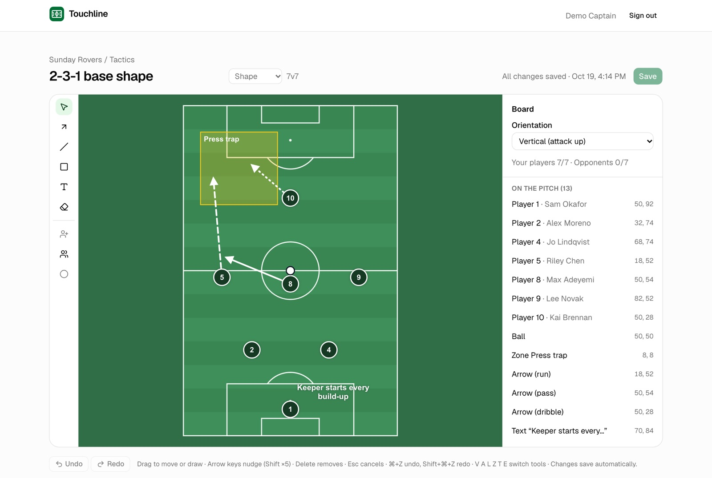
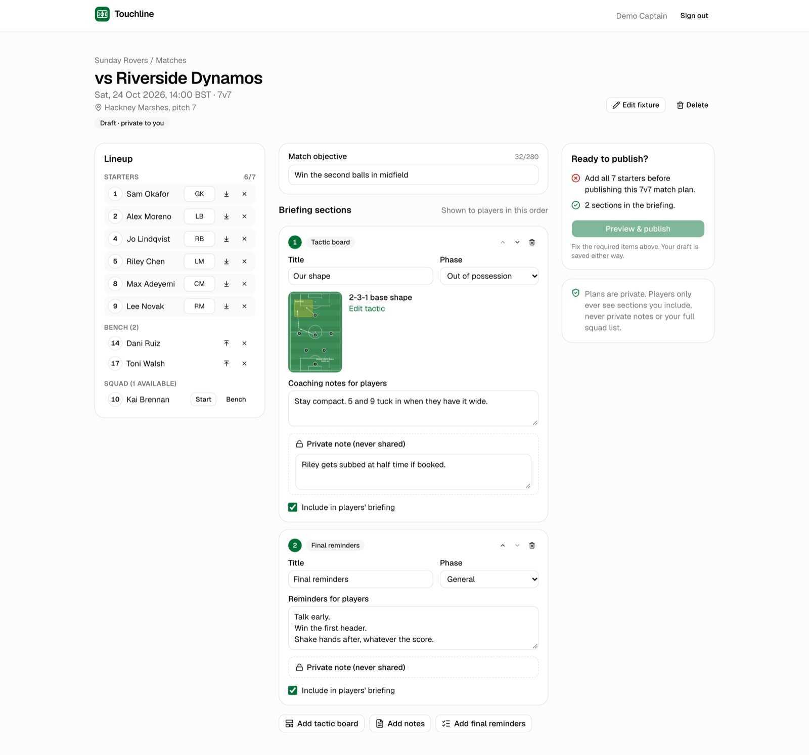
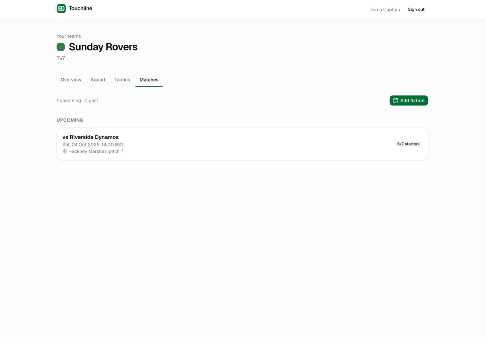
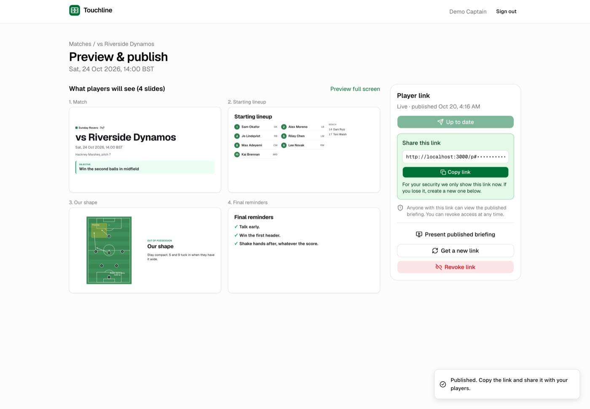
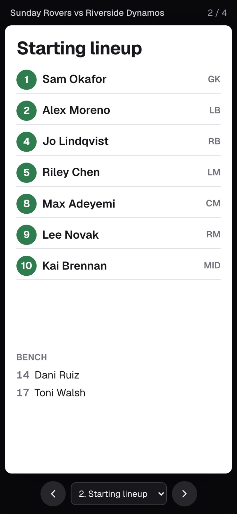

# Touchline

**Match preparation for grassroots football captains.** Pick the squad, draw the shape, plan Saturday, and send players a briefing they can open on their phones.

**▶ Live demo: _link added after deployment_.** Click **"Try the demo, no sign-up"** and you're dropped into a private sandbox with a ready-made 7v7 team.

---

## Why this exists

If you've ever captained a Sunday-league side, you know where the plan lives: a WhatsApp thread, a photo of a whiteboard, and the captain's head. By kickoff, half the team has a different idea of who's playing where.

Plenty of tools already draw tactics. What I couldn't find was the boring, joined-up part: the same squad flowing into this week's lineup, the shape you drew last month reused for this opponent, and one clean briefing that players actually open. That continuity, from **squad → fixture → lineup → tactics → briefing**, is the bet behind Touchline.

That's a hypothesis, not a finding. I haven't run user interviews or a pilot yet, and the docs say so plainly. You can read the full product thinking in the **[case study](docs/product/CASE-STUDY.md)**.

## What it does

| | |
|---|---|
| **1. Squad.** Add players once: names, shirt numbers, positions. Archive people who've left without breaking old briefings. | **2. Shape.** Start from a 5, 7 or 11-a-side formation. Drag players, draw runs and passes, mark zones, add notes. Undo anything. |
|  |  |
| **3. Plan.** Pick Saturday's lineup, attach tactics, write notes for players *and* private notes only you see. It won't let you publish an incomplete lineup. | **4. Briefing.** Publish a frozen briefing behind a private link. Players need no app and no account. You can present it full screen, print a PDF, or switch the link off. |
|  |  |

## Try it in two minutes
1. Open the live demo and click **Try the demo**.
2. Follow the tour card: squad → tactics board (drag a player, draw a run, press ⌘Z) → Saturday's match plan.
3. Hit **Preview & publish**, then open the player link on your phone.
4. Notice what's *not* there: the private note on the first section, and the squad members who weren't picked.

## Product docs
The specs came first, and the build was checked against them. Every decision that deviated from them is logged.

| Document | What's in it |
|---|---|
| [Case study](docs/product/CASE-STUDY.md) | The problem, the bets, the trade-offs, and what's still unproven |
| [PRD](docs/specs/01_Touchline_PRD.md) | Goals, scope, requirements with acceptance criteria, launch gate |
| [UX blueprint](docs/specs/02_Touchline_UX_Blueprint.md) | Screens, journeys, interaction states, microcopy |
| [Technical spec](docs/specs/03_Touchline_Technical_Spec.md) | Architecture, data model, security model, test strategy |
| [Delivery & QA plan](docs/specs/04_Touchline_Delivery_QA_Plan.md) | Phasing, backlog, QA matrix, analytics plan |
| [Decision register](docs/DECISIONS.md) | 48 product and engineering decisions, each with the reason |
| [Traceability matrix](docs/TRACEABILITY.md) | Every requirement → code → the tests that prove it |
| [Release assessment](docs/RELEASE-ASSESSMENT.md) | A candid "is it ready?" against the PRD's own launch gate |
| [Build evidence](docs/evidence/) | Per-phase notes: what was built, tests run, bugs found, screenshots |

## How it was built
I worked as the product owner, with an AI coding agent (Claude Code) as the engineer. It worked from a spec pack and an [implementation brief](docs/specs/05_Touchline_Claude_Code_Brief.md). We went phase by phase: it proposed a plan, I made the calls that were mine to make (hosting, email confirmation, how public links are rate-limited, the PDF engine, how the demo works), and each phase ended with written evidence (tests actually run, bugs found, screenshots) before the next began. The [case study](docs/product/CASE-STUDY.md#working-with-an-ai-engineer) covers what that looked like, including the bugs that testing surfaced along the way.

**Stack:** Next.js 16 (App Router) + TypeScript, React Konva for the editor, Supabase (Postgres, Auth, row-level security), Zod, Tailwind + shadcn/ui, react-pdf. Tested with Vitest, Playwright and pgTAP.

**A few things I cared about:**
- **Privacy by default.** Every table is locked to its owner in the database itself (row-level security), and that's tested with "can user B see user A's data?" checks on every table. Share links are stored only as one-way fingerprints, and they sit in the URL fragment so they never show up in server logs.
- **What players see can't drift.** Publishing freezes a snapshot. The presenter, the phone view and the PDF all render from that one snapshot, so editing a tactic later doesn't silently change a briefing players already have.
- **Accessible.** Keyboard alternatives for everything on the canvas, and an automated WCAG 2.2 AA check on 13 screens.

**Quality at the time of writing:** 90 unit tests, 119 database assertions and 50 end-to-end browser tests. They cover every P0 requirement in the PRD ([details](docs/TRACEABILITY.md)).

## Status and honest caveats
- An MVP built as a portfolio project. Not yet tested with real captains or on real phones.
- The demo sandbox deletes itself after 24 hours.
- See the [release assessment](docs/RELEASE-ASSESSMENT.md) for the full list of what's verified and what isn't.

## Running it locally
See **[docs/DEVELOPMENT.md](docs/DEVELOPMENT.md)** (Node 22 and Docker). Deployment steps are in [docs/DEPLOY.md](docs/DEPLOY.md).

---
Built by **Aditya Hasija**, product manager.
